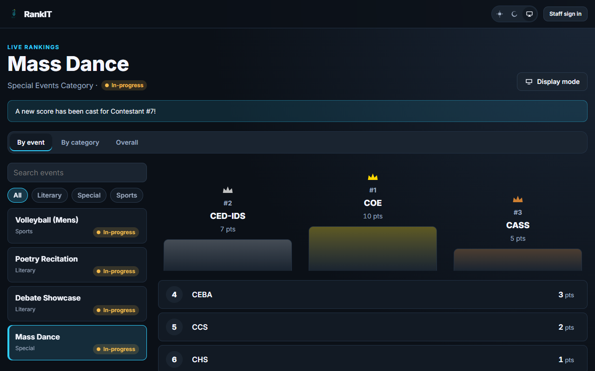
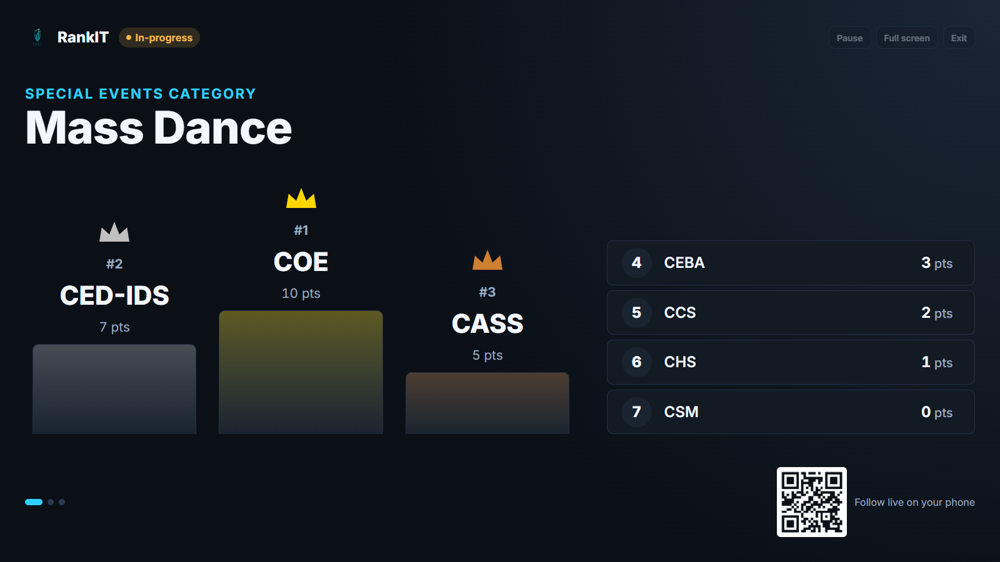
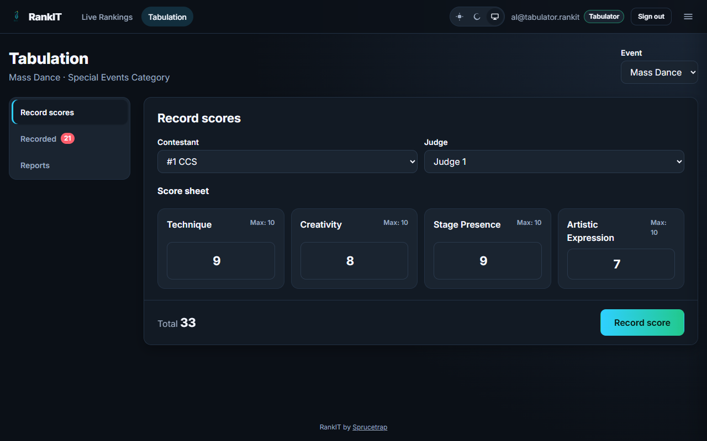
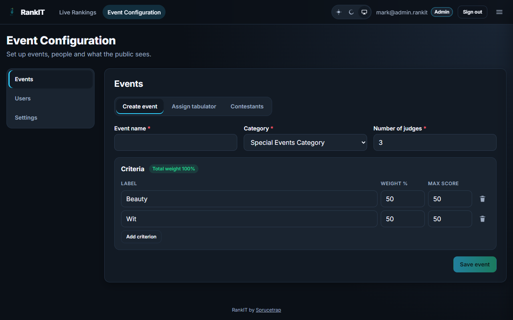
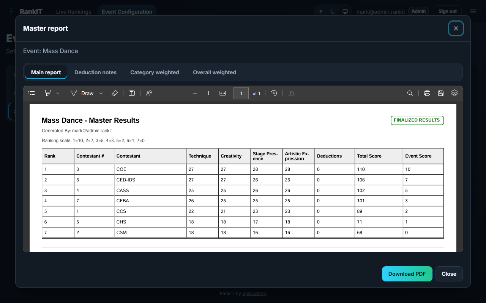
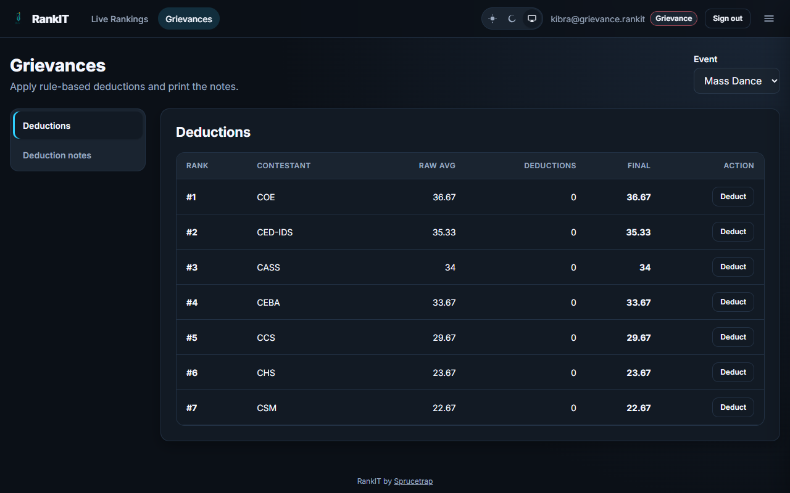
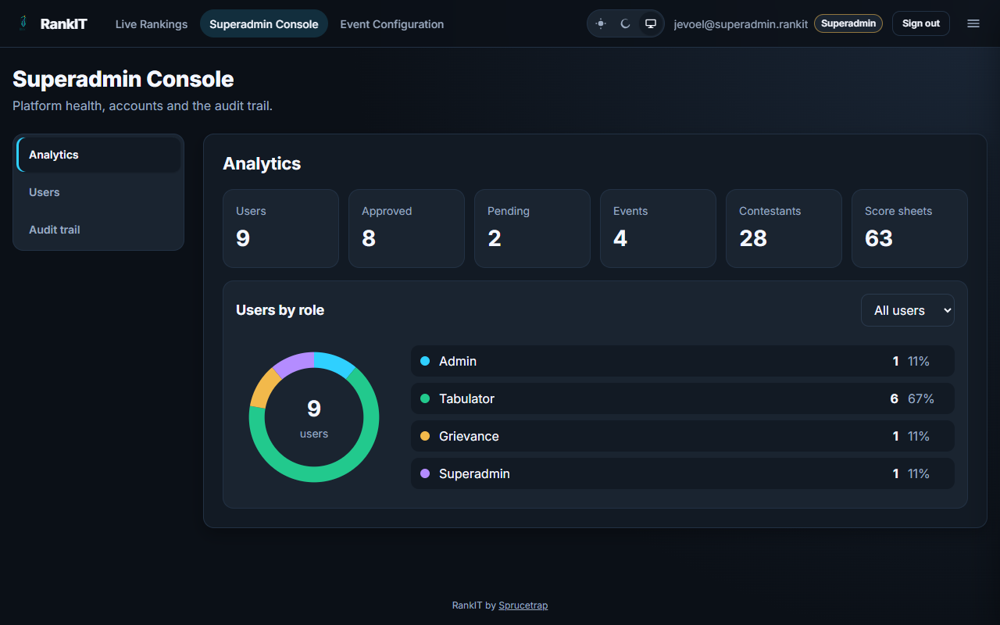
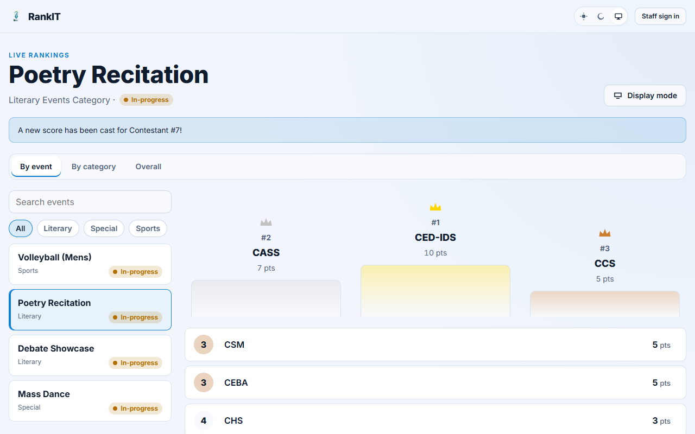
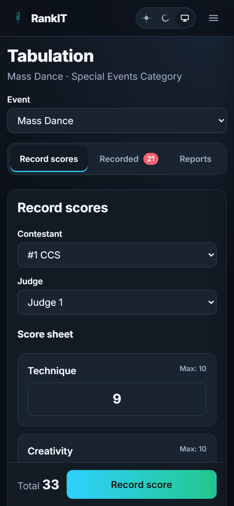
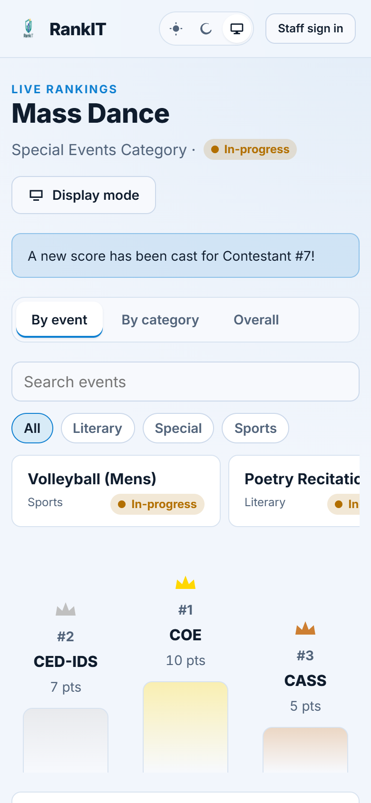

<div align="center">
  
  <h1>RankIT</h1>
  <p>Live, role-based tabulation and rankings for school events.</p>

[](backend/package.json)
[](LICENSE)
[](https://github.com/Jevoel16/RankIT/actions/workflows/ci.yml)
[](#getting-started)

</div>

---

## About

RankIT runs the scoring side of school competitions: admins set up events and criteria, tabulators record judges' scores, grievance officers file deductions, and everyone else watches live rankings on a public page. It replaces spreadsheets passed between judges with one auditable system that computes event, category and overall weighted rankings and prints the official reports.

[Back to top](#rankit)

---

## Screenshots

<details>
<summary><b>Screenshots</b></summary>

<table>
  <tr>
    <td width="50%" align="center"><b>Live rankings</b><br><a href="docs/images/community.png"></a></td>
    <td width="50%" align="center"><b>Display mode</b><br><a href="docs/images/display-mode.png"></a></td>
  </tr>
  <tr>
    <td width="50%" align="center"><b>Tabulator scoring</b><br><a href="docs/images/tabulator-scoring.png"></a></td>
    <td width="50%" align="center"><b>Event setup</b><br><a href="docs/images/admin-create-event.png"></a></td>
  </tr>
  <tr>
    <td width="50%" align="center"><b>Master report</b><br><a href="docs/images/master-report.png"></a></td>
    <td width="50%" align="center"><b>Grievance deductions</b><br><a href="docs/images/grievance-deductions.png"></a></td>
  </tr>
  <tr>
    <td width="50%" align="center"><b>Admin analytics</b><br><a href="docs/images/superadmin-analytics.png"></a></td>
    <td width="50%" align="center"><b>Light theme</b><br><a href="docs/images/community-light.png"></a></td>
  </tr>
  <tr>
    <td width="50%" align="center"><b>Phone (tabulator)</b><br><a href="docs/images/phone-tabulator.png"></a></td>
    <td width="50%" align="center"><b>Phone (live rankings, light)</b><br><a href="docs/images/phone-community-light.png"></a></td>
  </tr>
</table>

</details>

[Back to top](#rankit)

---

## Features

- Public live leaderboard by event, category and overall weighted ranking
- Big-screen display mode for projectors, with auto-rotating views and a QR code
- Role consoles for admin, tabulator and grievance staff, built for phones and tablets
- Criteria-based and set-based (sports) scoring with automatic rankings
- Accounts are created by signing in with Google or GitHub; admins assign each person's role
- Sign in later with Google, GitHub or a username and password set at first sign-in
- A superadmin can only recover admin access: promote an admin or reset an admin's password
- Auditable grievance deductions with reasons
- Master report PDFs: main results, deduction notes, weighted rankings
- Audit trail and analytics for admins
- Light, dark and system themes; works on phones and tablets

[Back to top](#rankit)

---

## Tech Stack

| Layer | Tools |
|---|---|
| Frontend | React 19.3.1, React Router 6.30.6, Vite 6.4.5, @react-pdf/renderer 4.9.0, qrcode 1.5.4 |
| Backend | Node.js 22.14.0, Express 5.2.1, Mongoose 9.12.0, Zod 4.6.7, Helmet 8.3.0 |
| Database | MongoDB (Atlas in production) |
| Testing | Vitest 4.1.12, Supertest, mongodb-memory-server |
| Hosting | Vercel (one project: static app + API function), MongoDB Atlas |

[Back to top](#rankit)

---

## Getting Started

Prerequisites: Node.js 22+, and MongoDB running locally (or an Atlas URI).

```bash
cp backend/.env.example backend/.env           # then set JWT_SECRET
npm ci --prefix backend && npm ci --prefix frontend-react
npm run seed:users --prefix backend && npm run seed:events --prefix backend
npm run dev --prefix backend                   # API on http://localhost:5000
npm start --prefix frontend-react              # app on http://localhost:3000
```

The seeders create demo accounts such as `mark` (admin) and `al` (tabulator) with the password from `SEED_PASSWORD` (default `1234`). They only run against a local database.

[Back to top](#rankit)

---

## Configuration

The API reads `backend/.env`; see [`backend/.env.example`](backend/.env.example). The frontend needs no variables in development: Vite proxies `/api` to the API.

<details>
<summary><b>Environment variables</b></summary>

| Variable | Where | Purpose |
|---|---|---|
| `MONGODB_URI` | backend | MongoDB connection string |
| `JWT_SECRET` | backend | Signs session cookies; use a long random value |
| `JWT_EXPIRES_IN` | backend | Session length, e.g. `12h` |
| `APP_URL` | backend | Public URL used for OAuth redirect URIs (defaults to the Vercel production domain) |
| `GOOGLE_CLIENT_ID`, `GOOGLE_CLIENT_SECRET` | backend | Enables "Continue with Google" (optional) |
| `GITHUB_CLIENT_ID`, `GITHUB_CLIENT_SECRET` | backend | Enables "Continue with GitHub" (optional) |
| `CORS_ORIGIN` | backend | Extra allowed browser origins (optional: the app and API share one origin) |
| `PORT`, `HOST` | backend | Local server bind (default `5000`, `0.0.0.0`) |
| `SEED_PASSWORD` | backend | Demo password for the local seeders |
| `VITE_DEV_API_TARGET` | frontend | Where the dev proxy sends `/api` (default `http://localhost:5000`) |
| `VITE_API_URL` | frontend | Only if the API is on another origin (default `/api`) |

</details>

[Back to top](#rankit)

---

## Usage

1. **Admin** creates an event with its criteria (or sets for sports), adds contestants and assigns a tabulator.
2. **Tabulator** records each judge's scores; rankings update immediately.
3. **Grievance** files deductions with a reason when a rule is broken.
4. **Everyone** follows the public page at `/`; admins choose which events and ranking views are visible. Put `/display` (or `/display/<eventId>`) on a projector: it rotates event, category and overall standings every 15 seconds (`?seconds=20`, `?rotate=0` to pin). Press F for full screen, Space to pause.
5. **Admin** prints the master report when the event is finalized.

New staff sign in with Google or GitHub, set a password, and wait while an **admin** assigns their role under **Users → New sign-ups**. Setup steps and the logos to upload are in [docs/deployment.md](docs/deployment.md#3-google-and-github-sign-in).

Deploying: import the repo into Vercel as one project (root directory = repo root); see [docs/deployment.md](docs/deployment.md).

[Back to top](#rankit)

---

## More

<details>
<summary><b>Project structure</b></summary>

```
backend/          Express API: routes, controllers, models, validation, tests, seed scripts
frontend-react/   React app: pages, components (ui kit), hooks, styles
api/              Vercel serverless entry (loads backend/server.js)
docs/             Deployment guide, screenshots, brand assets (logo exports for OAuth and social cards)
.github/          CI workflow
```

</details>

<details>
<summary><b>Scripts</b></summary>

| Package | Script | Does |
|---|---|---|
| backend | `npm run dev` | API with auto-reload |
| backend | `npm test` | API tests (in-memory MongoDB) |
| backend | `npm run lint` | ESLint |
| backend | `npm run seed:users` / `seed:events` | Local demo data |
| backend | `npm run create:superadmin` | Superadmin (admin recovery) for any database |
| backend | `npm run migrate:accounts` | One-off upgrade of pre-3.0 accounts (`-- --dry-run` to preview) |
| frontend-react | `npm start` | Dev server with `/api` proxy |
| frontend-react | `npm test` / `npm run lint` | Unit tests / ESLint |
| frontend-react | `npm run build` / `npm run preview` | Production build / serve it with production headers |

</details>

[Back to top](#rankit)

---

## Contributing

Work on a `feat/...` or `fix/...` branch and use Conventional Commits with the bumped version at the end of the subject, e.g. `feat: add CSV export (v2.5.0)`. Keep `npm run lint`, `npm test` and `npm run build` green, and update this README with every change.

[Back to top](#rankit)

---

## License

Source-available under the [Sprucetrap Source-Available License 1.0](LICENSE): free for non-commercial use with credit.

[Back to top](#rankit)

---

## Author

[Sprucetrap (@Jevoel16)](https://github.com/Jevoel16)

[Back to top](#rankit)
